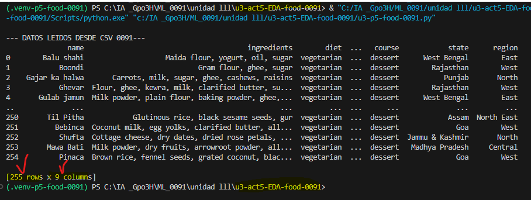
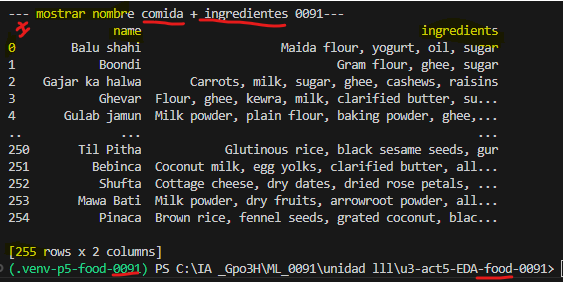
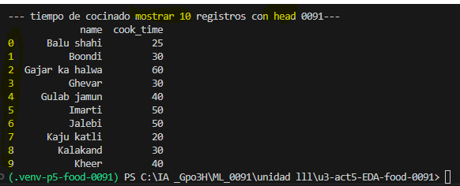
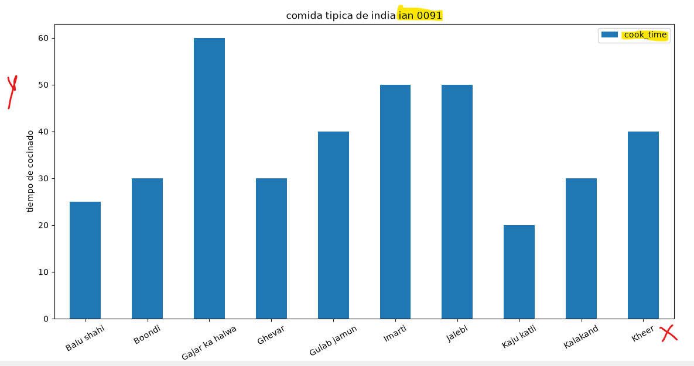
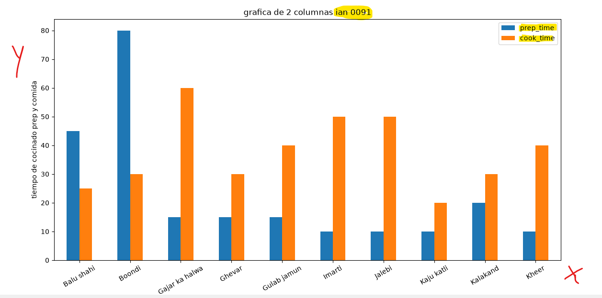
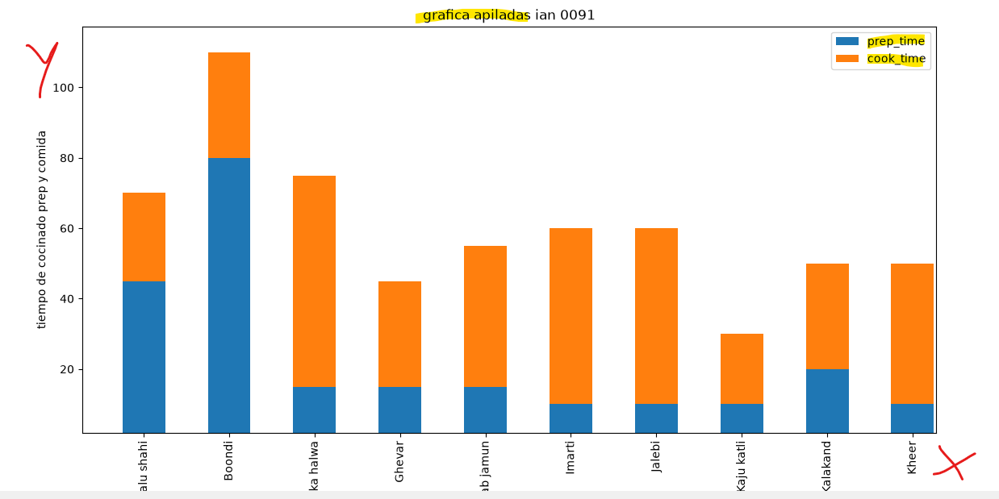

## analisis exploratorio de datos
## comida del pais india
## Ian gutierrez NC 0091
### +-+-+ importando datos del archivo csv comida de india +-+-+

## +-+-+ mostrar nombre comida + ingredientes

### tiempo de cocinado mostrar 10 registros con head

## creacion de grafica de barras 0091

## gráfica de varias columnas

## gráficas de barras apiladas 

## 
